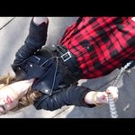

# Melletted

Melletted várom, hogy utolérjen az álom
A táj ma is élénk és szerelmünk félénk
Felhőket nem látsz ma, fogjunk tengertáncba
Tetoválja a vérünk belénk, hogy nem félünk.
Gyere hát, hova mész, miért nem vagy startra kész?
Hol a kulcs, hol a zár? Van egy hely, mi hazavár!
Refr. Velünk megállt az élet
Földre zuhant két lélek
Felettünk nincs árnyék
Mi volt, az nem fáj rég.

Fessük bele a tájba, rajzoljuk bele a fákba                
Hogy szabadon élünk, semmitől sem félünk
Csak mi vagyunk ketten, összefonódunk csendben 
Pihe könnyű az álom, benne arcodat látom!
Gyere hát, hova mész? Miért nem vagy startra kész?
Hol a kulcs, hol a zár, van egy hely, mi hazavár
Refr. (2x) Velünk megállt az élet
Földre zuhant két lélek
Felettünk nincs árnyék
Mi volt, az nem fáj rég.