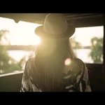

# Nekem a Balaton

## Dalszöveg

Nekem a Balaton

Intro
Nekem a Balaton, igazi jutalom, ahol nem törnek és zúznak a falakon.
Kérem az italom, igazi nyugalom, egész nap úszom vagy fekszem a teraszon.

1.Verse
Most elkísér az utamon a szél, és ölelése mindig utolér
Miért nem lehet mindennap ez, senki semmit nem feltételez
Jöhet akár a Don Juan, a véletlen mér nem segít
Feléd megyek és nem félek, hogy a tűz minket felhevít

Refr. 
Csak ülünk ketten a sziklaparton, köröttünk állnak az emberek
Nincs már semmi cél előttünk, a víz a napfénytől remeg.

Bridge 
Nekem a Balaton, igazi jutalom, ahol nem törnek és zúznak a falakon.
Kérem az italom, igazi nyugalom, egész nap úszom vagy fekszem a teraszon.

Verse 2.
Most elkísér az utamon a szél és ölelése mindig utolér
A láthatár ma szabadon vár egy vízcsepp mindig rám talál.
Elönt az ár, sietni kár, egy-két lány most felsikít    
Én ráérek és nem félek, a víz most minket elborít

Refr. 
Csak ülünk ketten a sziklaparton köröttünk állnak az emberek
Nincs már semmi cél előttünk a víz a napfénytől remeg

Szólógitár

Refr.
Csak ülünk ketten a sziklaparton köröttünk állnak az emberek
Nincs már semmi cél előttünk a víz a napfénytől remeg
Feléd úszom a napsütésben elérlek, beléd kapaszkodom,
Vigyél magaddal be a mélybe, veled ébren is álmodom
Csak ülünk ketten a sziklaparton köröttünk állnak az emberek
Nincs már semmi cél előttünk a víz a napfénytől remeg
Feléd úszom a napsütésben elérlek, beléd kapaszkodom,
Vigyél magaddal be a mélybe, veled ébren is álmodom